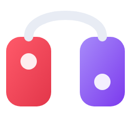
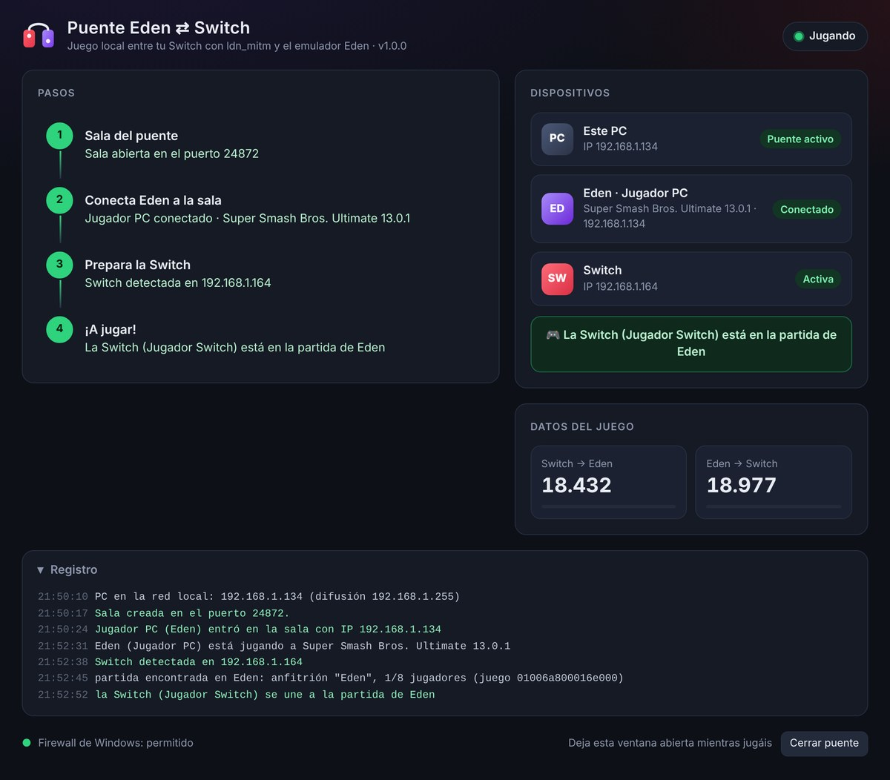
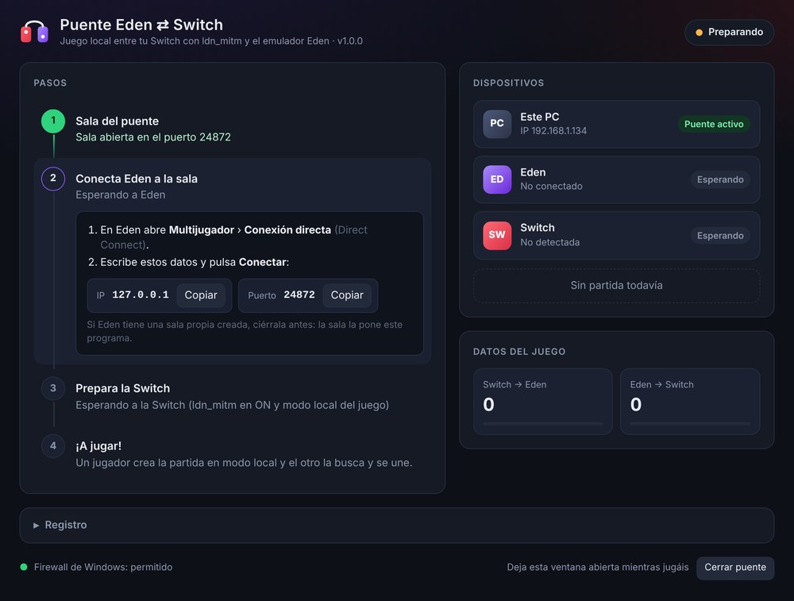

<p align="center">
  
</p>

<h1 align="center">Eden ⇄ Switch Bridge (Puente Eden ⇄ Switch)</h1>

<p align="center"><b>English</b> · <a href="README.es.md">Español</a></p>

<p align="center">
  Play <b>local wireless multiplayer</b> between a <b>real Nintendo Switch running ldn_mitm</b> and the <b>Eden</b> emulator on your PC.
</p>

<p align="center">
  
  
  
</p>

<p align="center">
  
</p>

> The program's interface is currently in Spanish. The steps below explain everything in English.

---

## What does it do?

Eden has its own local wireless (LDN) multiplayer through **rooms**, where emulators see each other as if they were on the same wireless network. **ldn_mitm** lets a real Switch play local wireless over your home WiFi. Both work in a similar way, but **they can't talk to each other**.

This program is a **translator** between them:

```
 ┌──────────────┐   home WiFi (ldn_mitm)   ┌────────────────────┐   Eden room   ┌────────┐
 │   Switch     │ ◀──────────────────────▶ │ Eden ⇄ Switch      │ ◀───────────▶ │  Eden  │
 │ with ldn_mitm│                          │ Bridge (your PC)   │               │  (PC)  │
 └──────────────┘                          └────────────────────┘               └────────┘
```

- To **Eden**, the Switch is just another player in the room.
- To the **Switch**, the PC is another console running ldn_mitm.
- Works **both ways**: either the Switch or Eden can host the match.

Tested with:

- **Super Smash Bros. Ultimate** (13.0.1)
- **Mario Kart 8 Deluxe**

## Features

- 🪟 **Window with guided steps** that turn green as each one is done.
- 🔎 **Finds the Switch automatically** and picks the right network adapter on the PC (even with VPNs or virtual adapters).
- 🏠 **Hosts the Eden room itself** and gives every player their real IP address, so games that store IP addresses inside their own packets (like Smash) work.
- 🛡️ **Sets up Windows Firewall** with one click.
- 📊 Live view of connected devices, match status and game traffic in each direction.
- 📦 A single `.exe`: no installation, no dependencies.

## Requirements

| | |
|---|---|
| **PC** | Windows 10 or 11 with Microsoft Edge (included with Windows) |
| **Eden** | *Emulation › Configure › Network* set to your network adapter |
| **Switch** | Atmosphère with **ldn_mitm** installed and compatible with your firmware |
| **Network** | Switch and PC connected to the **same router** |
| **Game** | The same game and the **same version** on the Switch and in Eden |

## How to use it

1. **Download** `PuenteEdenSwitch.exe` from [Releases](../../releases) and run it.
   If Windows SmartScreen warns you: *More info › Run anyway*.
2. **Eden**: close any room you created yourself. Then go to **Multiplayer › Direct Connect** and enter:

   | IP | Port |
   |---|---|
   | `127.0.0.1` | `24872` |

3. **Switch**: connect it to the same WiFi, open the overlay menu with <kbd>L</kbd> + <kbd>↓</kbd> + <kbd>R3</kbd> and turn **ldn_mitm ON**.
4. **Game**: open the same game on both, go to **local wireless** mode, host on one side and join from the other.

The window walks you through these steps and tells you what's missing:

<p align="center">
  
</p>


Keep the window open while you play. Closing it shuts the bridge down.

## Troubleshooting

<details>
<summary><b>"El puerto de la sala está ocupado" (room port is busy)</b></summary>

Eden is hosting its own room. Leave it with *Multiplayer › Leave Room* (or restart Eden). The bridge retries automatically.
</details>

<details>
<summary><b>The Switch doesn't show up</b></summary>

- Check that ldn_mitm is **ON** and the Switch is on the **same router** as the PC.
- Enter the game's local wireless mode: the Switch only announces itself while the game is searching for or hosting a match.
- If the Firewall warning appears at the bottom of the window, click **Permitir en el Firewall** (Allow in Firewall).
</details>

<details>
<summary><b>The Switch joins the match but drops out after a few seconds</b></summary>

- Make sure the game version is **exactly the same** on both.
- Use the room hosted by the bridge (Direct Connect to `127.0.0.1:24872`), not a room created in Eden.
</details>

<details>
<summary><b>Network error on the Switch when ldn_mitm is on</b></summary>

Check that your ldn_mitm version matches your firmware and Atmosphère, and that the Switch can connect to the internet with ldn_mitm off.
</details>

## Advanced options

No options are needed, but these are available (e.g. in a shortcut):

| Option | Purpose |
|---|---|
| `-switch 192.168.1.50` | Set the Switch IP if it isn't detected |
| `-ip 192.168.1.40` | Set the PC's LAN IP |
| `-puerto-sala 24872` | Change the room port |
| `-password text` | Set a room password |
| `-nombre Switch` | Name shown for the Switch in Eden |
| `-sala ip:port` | Join an existing Eden room instead of hosting one (legacy mode) |
| `-consola` | Use a console instead of the window |

## How it works

- **Switch side**: speaks the [ldn_mitm](https://github.com/spacemeowx2/ldn_mitm) LAN protocol (UDP discovery and TCP connection on port `11452`).
- **Eden side**: implements the Eden/yuzu room protocol over ENet, as both room server and client, and forwards game traffic (`ProxyPacket`, zstd-compressed).
- **Translation**: match information (`NetworkInfo`, `NodeInfo`) is passed between both sides, and the game's UDP packets are forwarded between your home network and the room.
- The interface is a local web page (`127.0.0.1:24880`) shown in its own Microsoft Edge app window.

## Building

Requires [Go](https://go.dev/dl/) 1.22 or newer.

```bash
# icon and manifest (creates rsrc_windows_amd64.syso)
go run ./tools/mkrsrc -o rsrc_windows_amd64.syso assets/icon-256.png assets/icon-64.png assets/icon-48.png assets/icon-32.png assets/icon-16.png

# windowed program
GOOS=windows GOARCH=amd64 go build -trimpath -ldflags "-s -w -H windowsgui" -o PuenteEdenSwitch.exe .
```

On Windows you can also run `build.bat`. Every published release is built by GitHub Actions and the `.exe` is attached to it automatically.

## Limitations

- **2 consoles** for now: one Switch and one Eden. Each side can still have **several players with their own controllers** (as many as the game allows per console), e.g. friends sharing the PC with Eden.
- Games that use **TCP** for the match won't work, because Eden rooms don't support it.
- **Experimental**: not every game has been tested. Reports are welcome in *Issues*.

## Credits

- [ldn_mitm](https://github.com/spacemeowx2/ldn_mitm) by spacemeowx2 and the [fork maintained by DefenderOfHyrule](https://github.com/DefenderOfHyrule/ldn_mitm).
- Eden, and before it yuzu and Citra, for the room protocol and local wireless emulation.
- [ENet](http://enet.bespin.org/), reimplemented here in Go.
- [klauspost/compress](https://github.com/klauspost/compress) for zstd.

## Disclaimer

Unofficial project, not affiliated with Nintendo or with the Eden or ldn_mitm developers. *Nintendo Switch* and *Super Smash Bros.* and *Mario Kart* are trademarks of Nintendo. This program does not include or provide games, firmware or keys: only use it with games you own legally.

## License

[GPL-3.0-or-later](LICENSE).
